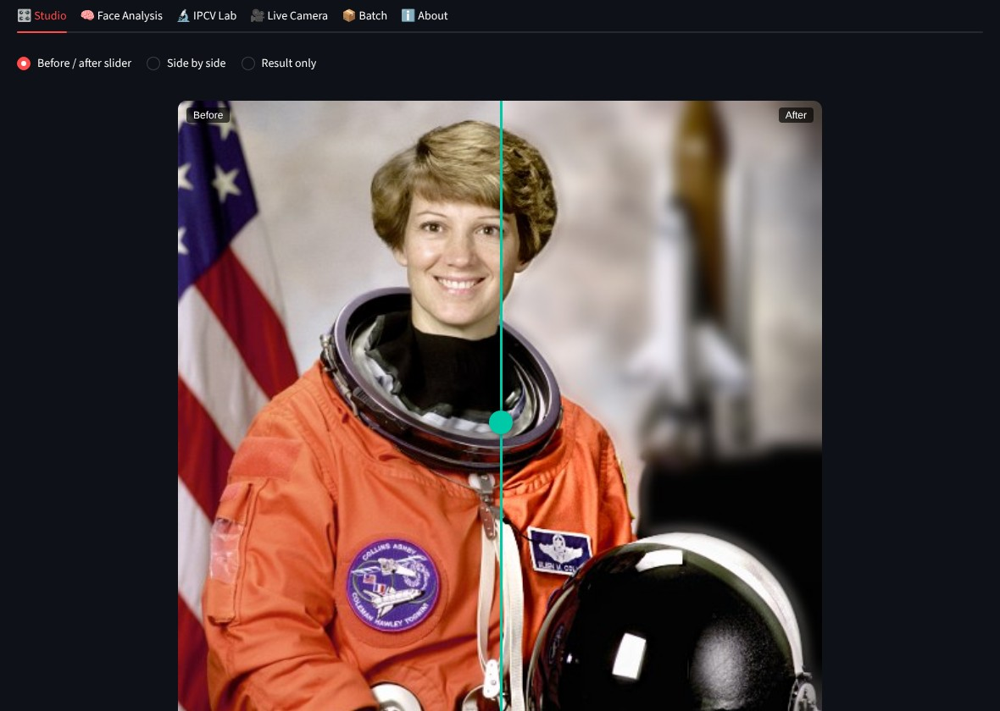
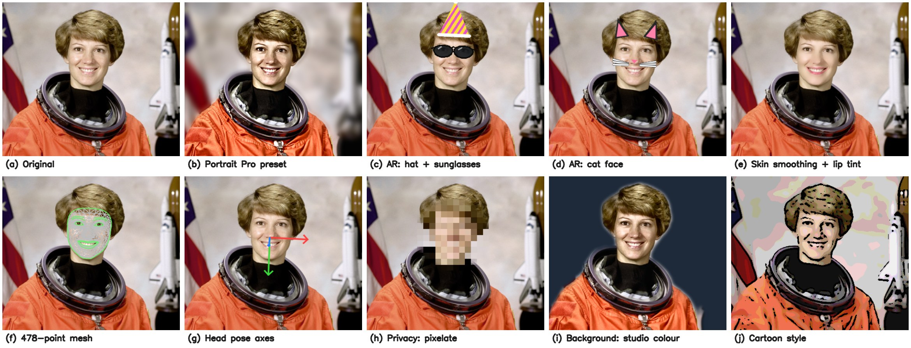
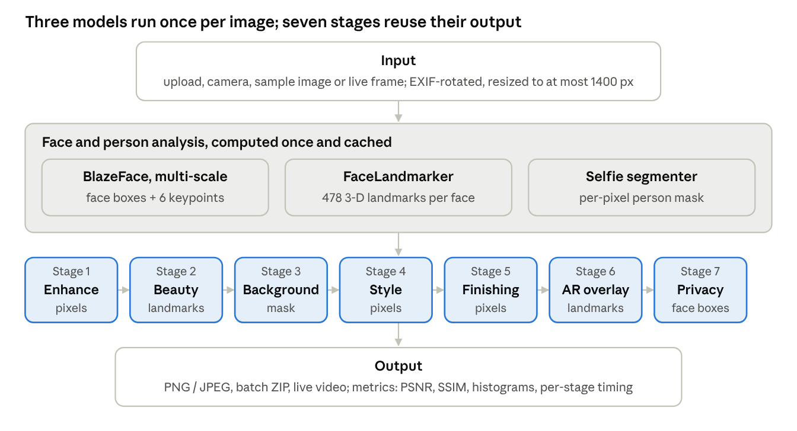
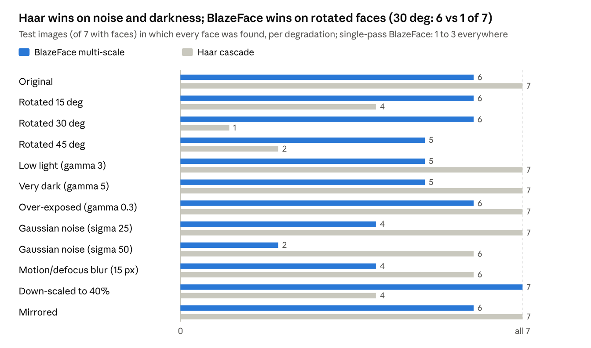

# Face Studio Camera & Image Forgery Detection

[](https://face-studio-camera.streamlit.app)

> 🚀 **Live Web App:** [https://face-studio-camera.streamlit.app](https://face-studio-camera.streamlit.app)  
> 🔍 **Forensics Backend API:** [https://image-tamper-detection.onrender.com](https://image-tamper-detection.onrender.com)

**Image Processing & Computer Vision (IPCV) Project · Section A · Team No. 1**  
**Topic:** *Forgery Detection and Localization using ELA, SIFT and CNN with Face Studio Camera*

Face Studio Camera & Forgery Detection is an integrated photo editing studio, live webcam system, and digital forensics suite built for our Image Processing and Computer Vision course. You can upload a photo (or use your webcam) to edit, enhance, anonymize, and inspect images, as well as perform forensic tamper detection to spot spliced, cloned (copy-move), and manipulated content.

Under the hood it mixes core syllabus techniques and modern deep learning:

- **Classical image processing** with OpenCV & NumPy: brightness, contrast, CLAHE, spatial filtering, edge detection, morphological operations, affine transforms, and the 2D Fourier transform (FFT).
- **Deep-learning face analysis** with Google MediaPipe: BlazeFace detection, 478-point 3D face mesh, head pose estimation, blink/mouth detection, and per-pixel person segmentation.
- **Digital image forensics:** Error Level Analysis (ELA), SIFT keypoint descriptor matching, PRNU camera sensor pattern noise consistency, JPEG ghost analysis, and deep convolutional neural network (CNN) tamper localization.

Everything runs locally on a laptop CPU, with instant cloud deployment on Streamlit Cloud.



---

## 📥 Project Deliverables & Downloads

| Deliverable | Format | File Link | Description |
|---|---|---|---|
| 📄 **Final Project Report** | PDF | [**`report/report.pdf`**](report/report.pdf) · [Root link](report.pdf) | Comprehensive 5-page IPCV project report with evaluation and benchmarks |
| 📝 **Project Report (Word)** | DOCX | [**`report/report.docx`**](report/report.docx) · [Root link](report.docx) | Fully formatted editable Word document |
| 📘 **Technical Guide** | PDF | [**`docs/guide.pdf`**](docs/guide.pdf) · [Root link](guide.pdf) | 39-page in-depth technical manual with worked numeric examples |
| 📊 **Presentation Slides** | PPTX | [**`presentation/presentation.pptx`**](presentation/presentation.pptx) · [Root link](presentation.pptx) | 14-slide defense presentation with module breakdowns & visual results |
| 💻 **Main Application** | Python | [`app.py`](app.py) | Streamlit interface, editing pipeline & live forensic integration |
| 🎯 **Evaluation Datasets** | Images / CSV | [`datasets/test_faces/`](datasets/test_faces) · [`sample_images/`](sample_images) | Benchmark test faces, ground truth annotations, and sample images |

---

## What it can do

**Studio tab: edit a photo in 7 stackable stages**

1. **Enhance:** brightness, contrast, saturation, gamma, sharpening, warmth, and one-click auto-enhance (CLAHE)
2. **Beauty:** skin smoothing that leaves the eyes and lips sharp, lip tint, eye colour
3. **Background:** portrait-mode blur, a solid colour, your own background photo, or "colour splash"
4. **Style:** 13 looks, including sepia, noir, cartoon, pencil sketch, watercolour, oil paint and thermal
5. **Finishing:** vignette and film grain
6. **AR overlays:** sunglasses, party hat, moustache, cat face (they follow the face's size and tilt)
7. **Privacy:** blur, pixelate, eye-bar or mask every face

You also get 7 one-click presets, a before/after slider you can drag, and a metrics panel showing PSNR, SSIM, histograms and how long each stage took.

**Face Analysis tab:** face detection with confidence scores, the 478-point face mesh, head pose (yaw, pitch, roll), blink and mouth-open detection, face symmetry, and a side-by-side **Haar cascade vs MediaPipe** comparison with a 12-condition robustness test.

**Image Forgery tab: digital image forensics & tamper detection**
- **Error Level Analysis (ELA):** Detects compression rate mismatches between host and spliced regions with interactive JPEG quality ($Q=90$) and scale amplification ($15\times$).
- **SIFT Copy-Move Keypoint Matching:** Identifies cloned and duplicated patches with Lowe's ratio test ($d_1/d_2 < 0.75$) and Euclidean spatial filtering ($D \ge 30\text{ px}$).
- **PRNU Sensor Noise & JPEG Ghost:** High-frequency noise variance consistency across $32\times 32$ blocks and secondary recompression error tracking.
- **Deep CNN Classifier & Localization Heatmaps:** Convolutional neural network predicting authentic vs manipulated probabilities with pixel-level Class Activation Heatmaps.
- **Unified Active Image Workflow:** Directly analyzes the active photo from the sidebar with one click via live Render API connection without re-uploading.

**IPCV Lab tab:** eight classic syllabus topics, live on your photo: colour spaces, histogram equalisation and CLAHE, noise and denoising, edge detection (Sobel, Prewitt, Laplacian, Canny), thresholding (Otsu, adaptive), morphology, frequency-domain (FFT) filtering, and geometric transforms.

**Image Forgery tab:** Companion project for digital image forensics using Error Level Analysis (ELA), SIFT keypoint matching, and Deep Learning (CNN) with localized tamper heatmaps. Direct links to the deployed app ([image-tamper-detection.onrender.com](https://image-tamper-detection.onrender.com)) and repo ([aaashishguptaaa/image-tamper-detection](https://github.com/aaashishguptaaa/image-tamper-detection)).

**Live Camera:** 15 real-time effects on your webcam, in the browser or in a separate desktop window.

**Batch tab:** run the same edits on a whole folder of photos and download them as a ZIP.



---

## How to run it

You need **Python 3.10 to 3.12** (3.13 also worked for us) and an internet connection the first time only.

### 1. Get the code

```bash
git clone https://github.com/aaashishguptaaa/IPCV_project.git
cd IPCV_project
```

Or download the ZIP from GitHub (green **Code** button → **Download ZIP**) and unzip it.

### 2. Create a virtual environment (recommended)

```bash
python -m venv venv
```

Then activate it:

- **Windows:** `venv\Scripts\activate`
- **macOS / Linux:** `source venv/bin/activate`

### 3. Install the libraries

```bash
pip install -r requirements.txt
```

This installs Streamlit, MediaPipe (which brings OpenCV with it), NumPy, Pillow, pandas, streamlit-webrtc and pytest. It takes a few minutes.

### 4. Download the face models (one time, about 5 MB)

```bash
python download_models.py
```

This saves three official MediaPipe model files into `models/`. After this step, the app works completely offline. (The Haar cascade file is already included.)

### 5. Check that everything works

```bash
python check_setup.py
```

You should see a list of **PASS** lines ending with *"All required checks passed – ready for the demo."* A WARN about the webcam just means no camera was found; the rest of the app still works.

### 6. Start the app

```bash
streamlit run app.py
```

Your browser opens at **http://localhost:8501**. In the sidebar, choose **Sample image** to try it straight away, or upload your own photo.

### Optional: the desktop live camera window

```bash
python live_camera.py
```

This opens your webcam in its own window, which is usually smoother than the browser. Keys:

| Key | What it does |
|---|---|
| `1`–`9`, `0`, `a`–`e` | Switch between the 15 effects (listed on screen) |
| `n` / `p` | Next / previous effect |
| `m` | Mirror on/off |
| `s` | Save a snapshot to `saved_images/` |
| `h` | Hide/show the help list |
| `q` or `Esc` | Quit |

If your laptop has more than one camera, try `python live_camera.py --cam 1`.

---

## Datasets

- **`sample_images/`:** the NASA astronaut portrait (public domain) that the app uses as its sample, and one photo with no face (a coffee cup) for testing.
- **`datasets/test_faces/`:** the 8 images we used to compare face detectors: 7 classic CMU/MIT face-detection test images that ship with OpenCV's own test data, plus the astronaut. They hold 20 faces in total, and one image has none, which checks for false alarms. `ground_truth.csv` lists the true number of faces in each image. More details are in [`datasets/README.md`](datasets/README.md).

To reproduce the numbers in our report:

```bash
python benchmark.py --images datasets/test_faces --gt datasets/test_faces/ground_truth.csv
```

The results are written as CSV files to `docs/results/`, together with annotated images in `docs/results/detections/` so you can check every box by eye.

To run the unit tests:

```bash
python -m pytest -q
```

---

## How it works (the short version)



Running a neural network is the slowest part, so the three MediaPipe models run **once per photo** and their results are cached. When you move a slider, only the cheap pixel operations run again. The seven stages always run in the same order, so effects stack predictably. For example, sunglasses are added after the cartoon style so they stay sharp, and privacy blur comes last so nothing can draw over a hidden face.

A few things we're proud of:

- **Multi-scale face detection.** MediaPipe's face detector is built for selfies and missed most faces in group photos (it found 2 of 20). We added tiled detection, which runs the detector on overlapping crops and merges the results with non-maximum suppression. That raised it to 16 of 20 with no false boxes.
- **AR overlays without image files.** Glasses and hats are drawn from shapes in a coordinate system attached to the face (origin between the eyes, unit = the distance between the eyes), so they fit any face size and tilt automatically.
- **Head pose without a 3D head model.** We build the head's own axes from MediaPipe's 3D landmarks using Gram–Schmidt, which worked better than the textbook `solvePnP` approach on our photos.

For the full explanation of every feature, with formulas and worked examples, see [`docs/IMPLEMENTATION.md`](docs/IMPLEMENTATION.md) and the [Technical Guide](docs/Face_Studio_Camera_Technical_Guide.pdf).

---

## Results at a glance

| Test | BlazeFace (1 pass) | BlazeFace (multi-scale) | Haar cascade |
|---|---|---|---|
| Faces found in the 8 test images (20 faces) | 2 (10%) | 16 (80%) | 20 (100%) |
| Images with all faces found after 30° rotation | 2 of 7 | 6 of 7 | 1 of 7 |
| Average time per image | 4.8 ms | 138 ms | 152 ms |

Haar is very good on upright, frontal faces like these classic test images, but it falls apart as soon as heads tilt. BlazeFace handles rotation well and a single pass is about 30× faster. The full results, including all 12 test conditions, are in the report and in `docs/results/`.



*Timings were measured on a 4-core CPU with no GPU, so your laptop's numbers will be a bit different.*

---

## Project structure

```
├── app.py                 The Streamlit app (6 tabs)
├── pipeline.py            The 7-stage editing pipeline and presets
├── filters.py             Enhancement, background compositing, 13 styles
├── face_utils.py          Face detector (multi-scale), face mesh, segmenter, Haar baseline
├── face_effects.py        AR overlays, beauty, privacy, head pose, blink detection
├── ipcv_lab.py            The 8 IPCV Lab demonstrations
├── metrics.py             PSNR, SSIM, entropy, sharpness, histograms
├── evaluation.py          Haar vs MediaPipe robustness experiment
├── live_effects.py        Per-frame live video effects and blink counter
├── live_camera.py         Desktop webcam window
├── benchmark.py           Reproduces the report's results
├── check_setup.py         Self-test before a demo
├── download_models.py     Downloads the MediaPipe models
├── requirements.txt
├── models/                Model files (Haar included; MediaPipe models downloaded)
├── sample_images/         Sample photos used by the app
├── datasets/test_faces/   Test images + ground truth for the benchmark
├── tests/                 Unit tests (pytest)
├── docs/                  Implementation notes, technical guide, demo script, results, screenshots
└── report/                Final project report (PDF and Word)
```

---

## Troubleshooting

| Problem | Fix |
|---|---|
| "Model … is not in models/" | Connect to the internet and run `python download_models.py` |
| `pip install mediapipe` fails | Your Python version is probably too new or too old; install Python 3.11 from python.org |
| The Live Camera tab doesn't start | Run `python live_camera.py` instead, or check that no other app is using the webcam |
| `live_camera.py` says OpenCV has no GUI | Run `pip uninstall -y opencv-python-headless`, then `pip install --force-reinstall mediapipe` |
| No faces found in a group photo | Keep **Multi-scale detection** switched on (sidebar → Face detection settings) |
| `ImportError: libGL.so.1` (Linux) | `sudo apt install libgl1 libglib2.0-0` |


---

## Credits

- Face models: [Google MediaPipe](https://ai.google.dev/edge/mediapipe) (Apache 2.0)
- Haar cascade and test images: [OpenCV](https://github.com/opencv/opencv) and [opencv_extra](https://github.com/opencv/opencv_extra) (BSD licence); the CMU/MIT face test set is a standard research benchmark
- Sample portrait: NASA (public domain)

---

## Team Details (Section A · Team No. 1)

| Member | Roll Number | Primary Contributions |
|---|---|---|
| **Aashish Gupta Rauniyar** | 20233501 | Studio editing pipeline, presets, enhancement filters & quality metrics (PSNR, SSIM) |
| **Bishal Ranjan Sah** | 20233515 | Multi-scale face detection, 478-point mesh, head pose & Haar benchmark |
| **Anubhav Kaushik** | 20233068 | Person segmentation, background replacement, AR overlays, beauty & privacy filters |
| **Amit Kumar** | 20233046 | Digital image forensics & forgery detection (ELA, SIFT copy-move, CNN, noise & ghost) |
| **Ashish Gupta** | 20233511 | IPCV Concepts Lab (8 syllabus topics), live camera processing, UI design & testing |

Image Processing and Computer Vision Project · Section A · Team No. 1.
